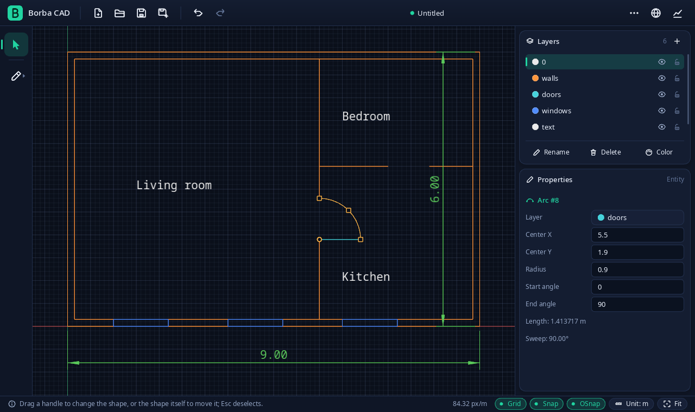
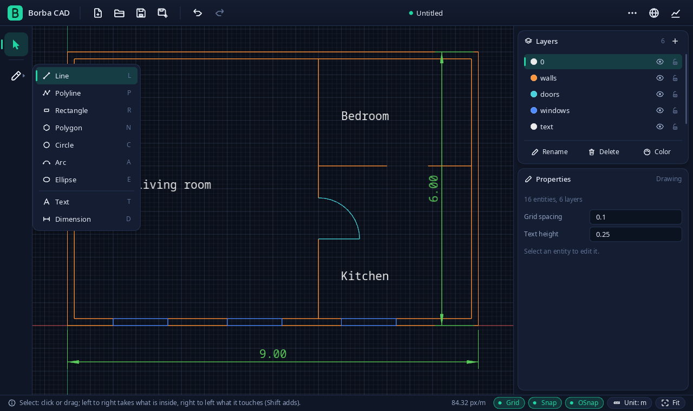
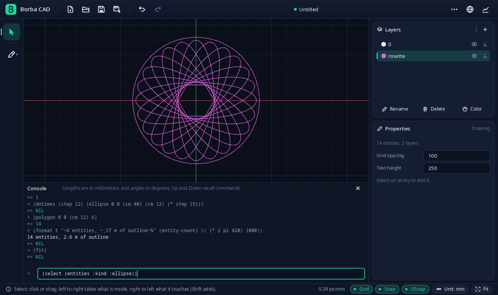
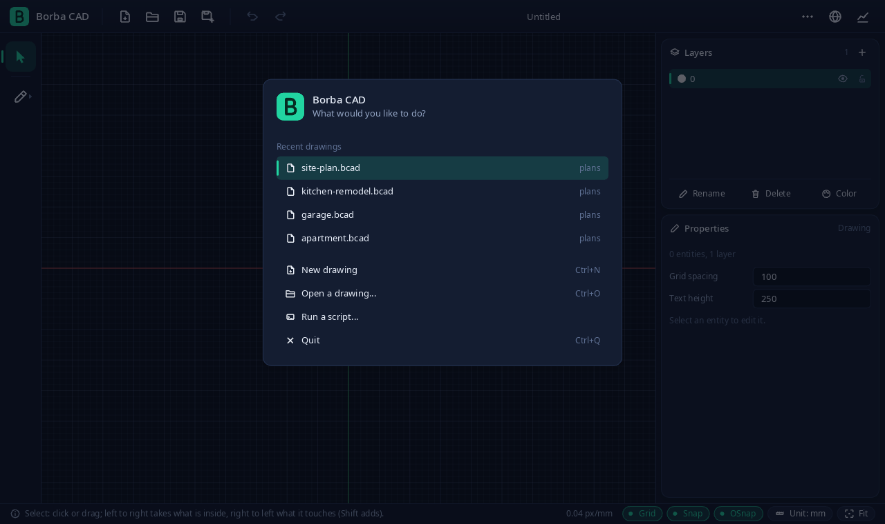
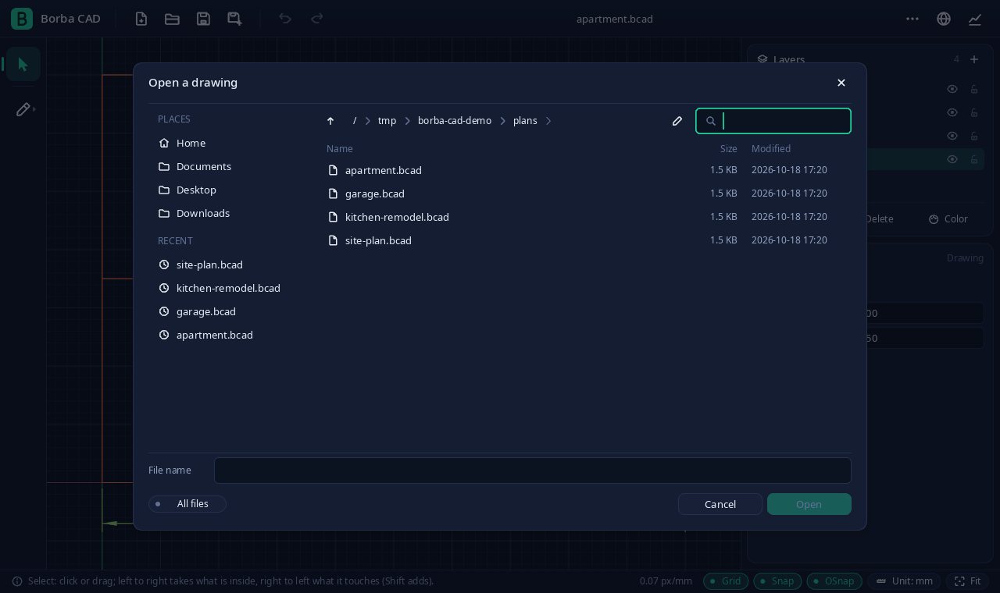
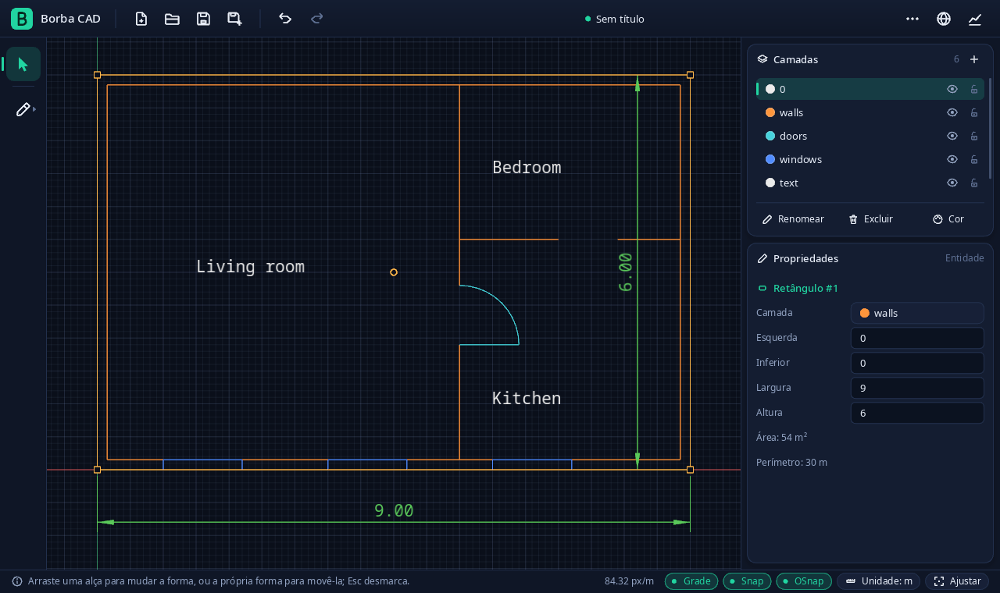
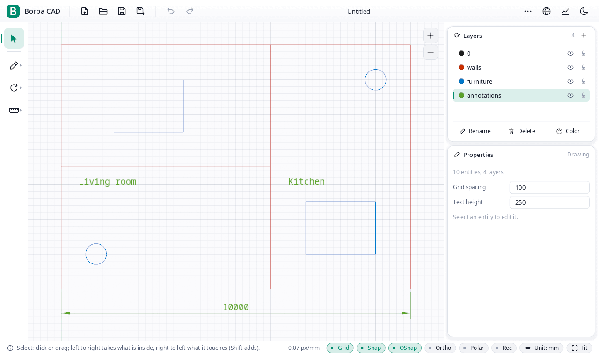

# Borba CAD

**A native 2D CAD written in Common Lisp, with a Lisp console that draws.**

[](https://github.com/AF2B/borba-cad/actions/workflows/ci.yml)
[](https://github.com/AF2B/borba-cad/releases)




Borba CAD is a desktop drafting program, and an engineering experiment: can Common Lisp carry a professional
CAD application, with tested geometry, measured performance and a codebase that stays maintainable? It runs on
SBCL with SDL2 and OpenGL, saves a versioned, human-readable file format, reads and writes DXF, and lets you
draw by typing Lisp into a console, because the language of the program is Lisp itself.

## Highlights

- **Drafting**: lines, polylines, rectangles, regular polygons, circles, arcs, ellipses, text at any angle and
  aligned, radius, diameter and angle dimensions, hatches and solid fills, on layers you can show, hide, lock and
  recolor.
- **Editing**: window and crossing selection, grips to stretch and turn what is selected, a numeric inspector
  for every property, rotate, mirror, scale, trim, extend, offset, fillet, spread, blocks, copy and paste (also
  between windows), and undo and redo of everything.
- **Precision**: grid snap and object snap (endpoints, midpoints, centers, intersections, quadrants and, from
  the last point, perpendiculars and tangents), ortho and polar, points you can type, millimetres inside,
  shown in mm, cm or m, and doubles that are saved and read back exactly.
- **A Lisp console**: `(rect-size 0 0 (m 9) (m 6))` draws; any Common Lisp works; a command is one step of
  undo, and one that fails leaves nothing behind. Scripts run from files, drawings export as scripts, and what
  you do in the editor can be recorded as one.
- **Tracing**: put a PNG, a JPEG or a page of a PDF under the drawing and calibrate it with two distances you
  know; the readers of the three formats are written in Lisp.
- **More tools**: union, subtract and intersect of closed shapes, arrays in a grid, round a point or along a path,
  quantities and a cut list with CSV, a library of shapes (acanthus leaves, SVG files of your own), parametric
  blocks drawn by code, and a command palette (`Ctrl+K`) over your own commands in `init.lisp`.
- **Files**: its own `.bcad` format (text, versioned, never evaluated), DXF import of any ASCII version and DXF
  R12 export, a JPEG of what the canvas shows, and PDF and SVG sheets to print at a scale, with a print layout of
  sheets, viewports and title blocks.
- **Friendly**: a start screen with your recent drawings, a file dialog with places and search, a dark and a
  light theme one click apart, zoom buttons on the canvas, and the interface in English, Brazilian Portuguese
  or Russian.
- **Measured**: every operation is timed and logged; benchmarks and a session log back the numbers.

## Screenshots

| | |
|:---:|:---:|
|  |  |
| **One button for every drawing tool**, each with its key | **The console**: Lisp that draws, with `format`, loops and the commands |
|  |  |
| **Start screen** with the recent drawings and the first things to do | **File dialog** with places, recent drawings and search |


<p align="center"><b>The same drawing in Brazilian Portuguese</b>, with a rectangle selected: area and perimeter in the inspector.</p>


<p align="center"><b>The light theme</b>: the sun and moon button at the right of the title bar switches it, the layer colors are darkened to read on white, and the zoom buttons sit in the corner of the canvas.</p>

## Download

| System | How |
|---|---|
| **Windows** | Download the `.zip` from the [releases](https://github.com/AF2B/borba-cad/releases), extract it, double-click `borba-cad.exe`. Windows warns about an unknown app because the program is not signed: choose *More info*, then *Run anyway*. If it does not start, `borba-cad-console.exe` shows why. |
| **Linux** | Download the `.tar.gz` from the [releases](https://github.com/AF2B/borba-cad/releases) (or build the folder with `make dist`, see below), unpack it anywhere and double-click `Borba CAD.desktop`; `./install.sh` adds it to the applications menu and opens `.bcad` files with it. |

Both folders carry the libraries and the fonts they need, so nothing has to be installed. **A version is a tag
of the repository**: every tag that reads `vMAJOR.MINOR.PATCH` is a version, and [GitHub Actions](.github/workflows/ci.yml)
makes its release with the Linux and the Windows programs, their checksums and the notes from the
[changelog](CHANGELOG.md); no program is built by hand. The Windows build is made on a Windows machine of GitHub
and has not yet been tried on a real one; see [docs/development.md](docs/development.md#windows).

## Build from source

| What | Tested with |
|---|---|
| SBCL | 2.6.9 (2.4 or newer is accepted, with a warning) |
| Quicklisp | installed at `~/quicklisp`, dist `2026-01-01` (checked by `make check-env`) |
| Native libraries | SDL2 (`sdl2-compat` works), OpenGL 3.3, FreeType plus its headers, `gcc` |
| Fonts | Noto Sans and Noto Sans Mono (DejaVu or Liberation also work), or one named by `--font FILE` / `BORBA_CAD_FONT` |
| A graphical session | Wayland or X11, for the window; everything else runs headless |

```bash
make check-env   # what is installed, what is missing, and how to fix it
make test        # headless correctness suites
make run         # open the window
```

Open a drawing at startup with `make run FILE=examples/floor-plan.bcad`, change the log verbosity with
`LOG_LEVEL=debug`, pass any program option with `ARGS="..."`; the program also takes the drawing as an argument:
`borba-cad plan.bcad`.

<details>
<summary><b>All the make targets</b></summary>

`make help` lists them all. The main ones:

| Target | Purpose |
|---|---|
| `check-env` | Verify SBCL, Quicklisp dist, native libraries, font and display session |
| `compile` / `build` | Strict rebuild of every system (any warning fails) / the same, then the executable |
| `lint` | Source rules, a docstring for every exported symbol, one-parameter-per-line layout, core dependencies, translations |
| `test` / `test-gui` | Headless suites / window-program tests (renderer tests skip with a message without a display) |
| `check` | `compile`, `lint`, `test` and `test-gui` |
| `run`, `demo`, `debug`, `repl` | Run the program, a scripted demo with a screenshot, run under the Lisp debugger, an interactive session |
| `exe` / `run-exe` | Standalone executable `build/borba-cad` |
| `dist` / `dist-check` | Linux folder to double-click and its `.tar.gz` in `dist/` / start it in a clean environment and check it uses its own libraries and fonts |
| `dist-windows` | Windows folder and `.zip`, in an MSYS2 shell (the pipeline runs it on GitHub) |
| `version` | The version: the nearest version tag (`1.3.0`, or `1.3.0-4-g1a2b3c4` four commits past it) |
| `bench`, `bench-gui`, `bench-quick` | Benchmarks, written to `bench/reports/` |
| `logs-tail`, `logs-summary` | Follow the log, aggregate it per event (no GUI needed) |
| `example`, `docs` | Regenerate `examples/floor-plan.bcad`, regenerate `docs/reference.md` |
| `clean`, `distclean` | Remove build output / also logs, screenshots and non-baseline reports |

</details>

## Using the program

When it starts without a drawing, a **start screen** offers the drawings you worked on last (up to five, each
with its folder), a new drawing, a drawing to open, a script to run, or the way out; Escape goes on with an
empty drawing. The palette on the left holds the Select tool, the **Draw** button, which lists every drawing
tool with its key, the **Modify** button, which lists the tools that change what is drawn, and the **Measure** button. The title bar has the file and history buttons, the name of the drawing (a dot marks unsaved
changes), the **More** menu (DXF, JPEG, PDF, SVG, the console, the scripts and the recording), the language menu,
the performance overlay and the **sun and moon** button that switches between the dark theme and the light one.
The corner of the canvas has the **+ and - buttons**, which zoom by one notch of the wheel about the center of
the canvas. The side panel holds the layers and the properties, where every property of the selection is
editable as a number; input that makes no sense is refused with a message and the old value is kept. The
status bar shows the hint, the position of the pointer and the switches of the grid, the snaps, ortho, polar,
the recording, the unit and zoom to fit.

Select one entity and its **grips** appear: squares to change its shape, a circle to move it. Click picks an
entity (Shift+click adds or removes), dragging from left to right selects what lies inside the rectangle and
from right to left (dashed) what it touches, and dragging a selection moves it.

**Blocks.** Select entities, choose **Make block...** in the Modify menu (`Shift+B`), type a name and click the base
point: the entities become one placement of the block. **Insert block** in the Draw menu (`I`) asks which block, then
a click puts it down (a number typed before the click is the scale), and a second click turns it toward the pointer
(Enter keeps it straight, a number typed after the first click is the angle in degrees). **Explode** (`Shift+X`) turns
a placement back into its entities. A block is defined once and kept in the file; every placement draws, picks and
snaps like the entities it stands for, takes the layer of the placement, and has a position, scale, rotation and
flip that the inspector edits. Rotate, mirror and scale work on placements, and copy and paste carry the block along.
A block cannot hold a block. In the console: `with-block`, `make-block`, `insert`, `explode` and `blocks`.

**Explode** (`Shift+X`) takes the selected blocks, rectangles, polygons and polylines apart where they are: a block
into the entities it stands for, a shape into its sides, as lines. **Spread** (`Shift+P`) does the same and also
moves each piece 1 cm from the others: a rectangle, a polygon or a polyline into its sides, each moved straight out
of the shape; a circle into four arcs; a block into the entities it stands for, each moved away from the center of
the block. An open polyline moves its segments away from its center. Both act at once on what is selected, and
select the pieces. With nothing selected Spread waits for one click inside a shape, with a live preview under the
pointer, spreads it and gives way to Select; a number typed before the click is the distance (in the display
unit). Both are one step of undo, and a line, an arc, a text or an ellipse, which have no pieces, say so. In the
console: `explode` and `(spread ids 10)`.

**Hatch and Solid fill** are in the Draw menu. Click inside a closed shape (a rectangle, circle, ellipse,
polygon or closed polyline: the smallest one that holds the point is used) and it is filled, with a live preview
while you move. A hatch is lines at 45 degrees, half the text height apart; select it and the inspector changes
the pattern (lines, cross or solid; click the row to go through them), the angle and the spacing. The hatch is its
own entity with its own boundary, so deleting or moving the shape it was made from does not touch it, and its
pattern is anchored to its first vertex, so it moves and turns with it. Clicking a hatch picks it on its lines
or boundary, or anywhere inside when it is solid.

**Radius, diameter and angle dimensions** are in the Draw menu. For a radius or a diameter, click the circle or
the arc, then click where the leader should point; the text follows the leader and always reads left to right.
For an angle, click the vertex, a point on each arm and a last point for the arc: the side of the vertex that
this last click is on says which of the two angles the arms make is measured. All three keep their numbers
live: change the radius or the unit in the inspector and the text follows, and the grips turn the leader or
move the arms and the arc.

**Trim, extend, offset and fillet** are in the Modify menu (`Shift+T`, `Shift+E`, `Shift+O`, `Shift+F`) and work
on what you click, with nothing selected. Trim removes the part of a line, an arc or a circle that you click, up to
the nearest crossings with any other visible entity (a line may be left in two pieces; a circle becomes the arc
that is left). Extend lengthens the end of a line or an arc that is nearer to the click up to the next entity in
its way. Offset copies a line, circle, arc, rectangle, polygon or polyline: click the entity, then click on the
side and at the distance of the copy (or type the distance) and the copy goes on the same layer; a closed shape
grows when you click outside it and shrinks when you click inside. Fillet rounds the corner of two lines: click
each on the part that stays; the radius is remembered, starts at 100 mm, and a number typed before the first
click changes it (zero only takes the lines to the corner). Each one is a step of undo, and when it cannot do
what you clicked for, the status bar says why.

**Rotate, mirror and scale** work on the selection, so select first (the Modify button says so otherwise).
Rotate: click the center, then the direction to turn toward, or type the angle in degrees. Mirror: click the
two ends of the mirror line, then say whether to keep or delete the originals. Scale: click the base point,
then a reference and a target (the factor is their distance ratio), or type the factor. A live preview follows
the pointer, `Ctrl` on the last click keeps the originals and selects the copies, and the whole operation is
one step of undo. A rectangle turned to a slant becomes a closed polyline; entities on locked layers stay.

**Measure** (the ruler button, which needs no selection) measures without drawing anything. **Distance** (`M`):
click two points; the status bar gives the distance, how far apart they are along each axis and the
direction. **Angle** (`Shift+A`): click the vertex and a point on each arm; it gives the smaller angle and the
one that completes the turn. **Area** (`Shift+Q`): click the corners of a contour, close it with Enter or by
clicking the first corner (Backspace takes the last one back); it gives the area and the perimeter. While you
measure, the shape and its value show on the canvas, in the display unit of the drawing, and they stay there
until the next click starts another measurement or Esc leaves the tool. Ortho, polar, object snaps and typed
points work as they do when drawing.

<details>
<summary><b>Keys</b></summary>

| Keys | What they do |
|---|---|
| `Shift+R`, `Shift+M`, `Shift+S` | Rotate, mirror, scale the selection |
| `Shift+T`, `Shift+E`, `Shift+O`, `Shift+F`, `Shift+P` | Trim, extend, offset, fillet, spread |
| `M`, `Shift+A`, `Shift+Q` | Measure a distance, an angle, an area |
| `L` `P` `R` `N` `C` `A` `E` `T` `D` | Line, polyline (Enter finishes, the first vertex closes), rectangle, polygon (Up and Down set the sides), circle, arc (center, start, end counter-clockwise), ellipse (center, axis end, other half-axis), text (drag to turn it), dimension |
| The Draw menu | Also the **radius**, **diameter** and **angle** dimensions, which have no key |
| `Esc` | Cancel what the tool is doing, then back to Select, then clear the selection |
| `Delete`, `Ctrl+A` | Delete the selection, select all |
| `Ctrl+C`, `Ctrl+X`, `Ctrl+V`, `Ctrl+Shift+V` | Copy, cut, paste at the pointer, paste where it was copied from |
| `Ctrl+Z`, `Ctrl+Y` or `Ctrl+Shift+Z` | Undo, redo |
| Wheel, middle button or `Space`+drag, `Home` | Zoom at the pointer, pan, fit the drawing |
| `G`, `S`, `O`, `U` | Grid, grid snap, object snap (see below), display unit |
| `Ctrl+N`, `Ctrl+O`, `Ctrl+S`, `Ctrl+Shift+S` | New, open, save, save as (a drawing dropped on the window opens too) |
| `Ctrl+Shift+I`, `Ctrl+Shift+E` | Import DXF, export DXF |
| `F2`, `F3` | Console, performance overlay |
| `F8`, `F9`, `F10` | Ortho, record what you do as a script, polar |
| `Ctrl` + `+`, `Ctrl` + `-`, `Ctrl` + `0` | Make the interface larger, smaller, as designed (75% to 200%, remembered) |

</details>

## The console and scripts

`F2` (or More > Console) opens the console under the canvas. Type a Lisp expression and press Enter. Lengths are
millimetres and angles degrees, unless written `(rad x)`; `(mm 3)`, `(cm 20)`, `(m 5)`, `(inch 1)` and
`(foot 2)` give millimetres.

```lisp
(layer "walls" :color :orange)            ; makes the layer and draws on it from now on
(rect-size 0 0 (m 9) (m 6))               ; => 1   (every command that draws returns its id)
(dotimes (i 3) (circle (* i (m 2)) 0 300))
(text 100 100 "Living room" :height 250 :angle 15)
(move (entities :kind :circle) 0 (m 1))   ; ids, or lists of ids
(rotate 1 90 :about-x 0 :about-y 0)       ; also (mirror ids x1 y1 x2 y2) and (scale ids 2); :copy t keeps the originals
(edit 2 :radius 500)                      ; the properties the inspector lists
(format t "~d entities~%" (entity-count)) ; prints in the console
(select-all) (fit) (help)
```

The commands: `line rect rect-size circle arc ellipse polygon pline text dimension radius-dimension diameter-dimension
angle-dimension` draw; `move copy rotate
mirror scale erase edit redraw move-to-layer` change; `layer with-layer layers entities entity-count extents info` look and arrange;
`select select-all deselect selected fit` act on the window; `display-unit grid-spacing` set the drawing; `say`
and `help` talk, and `(help 'line)` explains one. Up and Down recall commands, Page Up and Page Down scroll, an
expression whose parentheses are still open waits for its next lines, `Ctrl+L` clears.

**It is native Lisp.** What you type is read and evaluated by SBCL in a package that has all of Common Lisp
and the commands, so `format`, `let`, `defun`, `loop`, `mapcar` and the rest work, and a function you define
stays defined. Numbers with a point are double-floats, and `sqrt`, `sin`, `cos`, `tan`, `asin`, `acos`,
`atan`, `exp`, `log` and `float` answer in double-floats even for a whole number (`(sqrt 2)` is
1.4142135623730951; `cl:sqrt` is still there).

**What keeps it safe:**

- **A command is one step of undo.** `Ctrl+Z` takes the whole command back. If a step fails, or the command
  runs more than 10 seconds (60 for a script file), or it makes more than two million changes, everything it
  did to the entities is put back. Layers and drawing settings are not part of that step, as in the layers
  panel. What a command prints is cut after 200,000 characters.
- **Reading never evaluates anything.** A `.bcad` file and the clipboard are never run, and the text of a
  command is read with the reader's evaluation off (`#.` is an error).
- **Scripts run only when you say so.** More > Run script... reads and checks the `.lisp` file, then asks
  where it draws: on **a new layer** of this drawing (named for the file, removed if left empty) or in **a new
  drawing**, with a reminder to run only files you trust.
- **The console is full Lisp,** with your permissions, internals and files included. That is what makes it
  useful; do not paste what you do not understand.

More > Export as script... writes the drawing as the commands that draw it again, bit for bit.

**Recording.** `F9`, the **Rec** chip in the status bar or More > Record actions starts a recording; the same again
stops it and asks where to save the script. The script is made from the steps of undo that came after the start,
so what you drew, moved, edited, erased, copied, rotated, trimmed or spread is in it, in order, and what you undid
is not: a new entity is the command that draws it, an erased one `erase`, a moved one `move` (several moved by
the same distance in one command), a changed property `edit`, and any other change `redraw`, which puts the new
entity in the place of the old one, keeping its number, its layer and its place in the drawing order. An entity
the recording made is named by a variable (`*line-12*`), because the number it will have when the script runs
is not the number it had; one that was already there is named by its number, so the script is run (More > Run
script, on a new layer) on the drawing as it was when the recording began. Layers and blocks are not steps of
undo, so the script makes the ones it uses. A rotation, a scale or a mirror is recorded as the entity it made, not
as the transform, and a recording is lost when the drawing is replaced or when you undo what came before it.
[`examples/house-plan.lisp`](examples/house-plan.lisp) and [`examples/rosette.lisp`](examples/rosette.lisp)
are scripts to read and run.

## Files and formats

- **`.bcad`**, the program's own format: UTF-8 text, one S-expression, an explicit `format-version` (9; versions
  1 to 8 open and are migrated), doubles that read back exactly. Loading never evaluates code; a malformed
  file is refused with its line and column, and a failed open leaves the open drawing untouched. Saving is
  atomic (temporary file, flush, rename).
- **DXF import** (More > Import DXF) reads an ASCII DXF of any version as a new drawing: layers, lines,
  circles, arcs, polylines, texts and multiline texts, ellipses, splines, leaders, filled shapes and 3D faces
  (as outlines), blocks (expanded, scaled, turned, mirrored, nested) and dimensions. It asks for the unit when
  the file does not say it, moves far-away drawings to the origin, and reports what it left out (hatches,
  points, images, paper space).
- **DXF export** writes R12, which every program reads: rectangles, polygons and ellipses as closed polylines,
  dimensions as lines, arrowheads and text, layers with the nearest of AutoCAD's 256 colors.
- **JPEG export** (More > Export as JPEG) saves what the canvas shows, at the view you have and as sharp as
  your display, without the panels, the selection or the cursor. The encoder is written in Lisp.

- **PDF and SVG export** (More > Export as PDF, Export as SVG) put the drawing on a sheet to a scale. Four
  questions come first: the sheet (A4, A3, A2 or A1), the scale (`1:50`, `1:100`, any ratio such as `1:75`
  or `2:1`, or `fit` to make the drawing as large as the sheet allows; the last answer is remembered), whether
  to print in black or in the colors of the layers (very light colors print black, as they would not show on
  white), and then the name of the file. The sheet is turned to suit the drawing, which goes in the middle
  inside a 10 mm margin, lines are 0.25 mm thick, and curves are drawn as segments within 0.02 mm of the true
  curve. The message at the end says the sheet and the scale, and warns when the drawing does not fit at that
  scale. The PDF is written by hand, with no library: vector paths and text in Courier, whose characters are as
  wide as the text of the program is measured, so what you see is what prints. Characters outside Latin-1, such
  as Cyrillic, cannot be written in that font and become question marks, which the message counts; the SVG
  keeps every character.

Exports end with a message in the middle of the window that says the file was saved or why it was not.

**Underlays.** More > Add an underlay (`Ctrl+Shift+U`) asks for a PNG, a JPEG or a PDF and puts it under the drawing.
A PDF asks for the page and the resolution first (`auto` reads a scan at its own resolution and a drawing of lines
at 150 dots per inch). Then click two points of the picture whose distance you know, type the distance (`12.5 m`,
or a number in the display unit) and choose how to turn the picture: leave it, make the line level or upright, or
aim it at an angle; the picture is scaled and turned about the first point. More > Underlays (or `Ctrl+K`) calibrates
again, changes the position, turn, size of a pixel, opacity, page and resolution, hides, shows, zooms to or removes
each one. The pictures are kept whole in the drawing file (up to 8, and 40 MiB together), are not printed or
exported, and are not steps of undo. PDFs: lines, curves, fills, clipping paths, images and text in the TrueType
and CFF fonts the file carries are drawn; text in fonts left out of the file, shadings and patterns are not, and
password-protected, fax and JPEG 2000 files are refused with the reason.

**Ortho, polar and typed points.** `F8` (the **Ortho** chip) holds the next point of a line, polyline or
dimension to a horizontal or vertical line from the last one, `F10` (**Polar**) to multiples of 15 degrees; an
object snap still wins. While a drawing tool waits for a point you can also **type it**:
start with a digit, `-`, `@` or `.` and a box opens. A length (`1500`) goes from the last point toward the
pointer (along the axis when ortho or polar holds it), `x;y` is an absolute point, `@x;y` is that far from the
last point, and `length<angle` (`1000<45`, degrees) is polar from it. Numbers are in the display unit unless
they say `mm`, `cm` or `m`. Enter accepts, Esc throws the text away.

**Object snap** (`O`, the **OSnap** chip) gives, near the pointer, the **endpoints** (square), **midpoints**
(triangle), **centers** (circle), **intersections** (cross) and **quadrants** (diamond) of the entities, and, once
a tool has its first point, the **perpendicular** (right angle) foot on a segment, circle or arc and the points
of **tangency** to a circle or arc from that point. At the same distance an endpoint wins over an
intersection, then the center, the midpoint, the quadrant, the perpendicular and the tangent. Hidden and
locked layers give none. Ellipses, texts and dimensions give their endpoints and centers only.

**Autosave.** While a drawing has changes that are not saved, a copy is written to the state directory every
minute (only when something changed) and taken away once the drawing is saved or closed. If the program
closes any other way, a crash or a power cut, the next start asks whether to recover it: **Recover** opens it
as work not yet saved, **Discard** throws it away, **Not now** keeps it for next time.

**The file dialog** lists folders first, then drawings with their size and date, with places (home,
documents, desktop, downloads, the sample drawings) and your recent drawings on the left. Click a step of the
path to go there, `Ctrl+L` to type a path, `Alt+Up` to go up; typing finds files as you type. The recent list
lives in the state directory (`--state-dir`); the dialog starts in the folder of the open drawing or in your
documents (`--drawings-dir`).

## Languages

English (US) is always the default. The globe in the title bar switches to **Português (Brasil)** or
**Русский (Россия)**, and the choice is kept for the next run; `--language pt-BR` or `BORBA_CAD_LANGUAGE`
override it. Each language is a data file in [`src/i18n/`](src/i18n), and the lint fails when a text of the
program has no translation.

## Window sizes

The window opens no bigger than 92% of the usable area of the screen, and can be as small as 640 x 400. The
layout is designed for 1100 x 640: in a window smaller than that the whole interface is drawn smaller (down to
60%) instead of being cut off, so every button stays in reach on a laptop screen or a high-DPI display at 150%.
`Ctrl` and `+`, `-` or `0` make the interface larger, smaller or as designed when the window has room, and the
choice is kept for the next run.

## Themes

The window starts dark. The sun and moon button at the right of the title bar switches to the **light theme**
and back, and the choice is kept for the next run; `--theme light` or `dark`, or `BORBA_CAD_THEME`, override it.
On the white canvas the colors of the layers are drawn darker where they would be too pale to see (a near-white
layer becomes near-black), in the canvas, in the layer swatches and in the JPEG, and never in the file, where
a layer keeps the color it was given.

## Observability

Every run writes a log (rotated, 5 files of 5 MiB), one line per event:

```
2026-10-14T03:22:52.259Z INFO file.load duration_ms=0.459 bytes=1462 entity_count=10 read_ms=0.155 parse_ms=0.280 result=success
```

Frames and input are aggregated once per second; `LOG_LEVEL=debug` adds every operation. `make logs-summary`
prints count, total, mean, p50, p95 and max per event. Durations come from the monotonic clock; what cannot be
measured is reported as unavailable, never estimated.

## Project layout

| Path | Contents |
|---|---|
| `src/` | The core (`borba-cad`, no window or foreign library): geometry, domain, viewport, persistence, DXF, images, the script language, observability, scene, UI and application; and `src/platform/` (`borba-cad/platform`): SDL window, OpenGL renderer, FreeType atlas, event loop |
| `tests/`, `platform-tests/` | FiveAM suites (headless / window program) |
| `test-support/`, `bench/` | Seeded workload generator; benchmarks (headless and windowed) |
| `scripts/` | Bootstrap, environment check, lint, build, packaging, version and release-notes tools |
| `.github/` | The [pipeline](.github/workflows/ci.yml): version, lint, test, Linux and Windows builds, documentation deploy and release |
| `docs/` | [Specification](docs/specification.md), [architecture](docs/architecture.md), [geometry](docs/geometry.md), [performance](docs/performance.md), [development guide](docs/development.md), [experiment report](docs/experiment-report.md), generated [API reference](docs/reference.md) |
| `examples/` | A sample drawing and two scripts |

## Status and known limits

The latest release is on the [releases page](https://github.com/AF2B/borba-cad/releases), and what `main` has that
no release has is in the [changelog](CHANGELOG.md) under *Unreleased*. The strict build has zero warnings, and the
lint, 260,000+ headless checks and 258 window checks pass. The benchmark baseline and the experiment report are
those of 1.0.0.

- Run on Linux x86_64 with SBCL; the Windows build is made by the workflow and has not yet been opened on a
  real Windows machine.
- Single-line text, axis-aligned rectangles and linear, radius, diameter and angle dimensions only; there is
  no printing from the program itself, only PDF and SVG sheets and a JPEG; the PDF font has no Cyrillic.
- Trim and extend work on lines, arcs and circles, a block cannot hold a block, a result of union, subtract or
  intersect made from a circle is a polygon, and the console has no command for trim, extend, offset, fillet or
  spread (a recording writes their result).
- Underlays are not steps of undo (calibrate again to put one right), a PDF page is read as a picture (its text is
  drawn only in fonts the file carries), and the pictures of a drawing make a large file that takes about a second to
  open.
- The DXF import was tried on test files and a few small files from the internet, not on a collection of real
  drawings.
- Portuguese and Russian keep the decimal point, and leave in English the console's error messages and the
  text of `help`. The Russian catalog has not been read by a native speaker.
- A console command runs on the window's thread, so the window waits for it (up to its limit), and a command
  that fails halfway leaves the layers it made.

## License

No license has been chosen yet, so all rights are reserved by the author for now.
